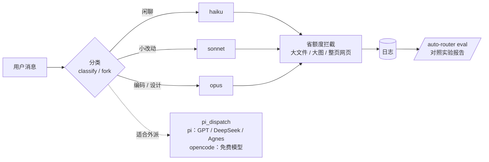

# auto-router

Claude Code 插件（mod）：**按问题自动切换 Claude 模型，把执行活派给更便宜的模型，拦住浪费上下文的读取，并用对照实验衡量到底省了多少。**

- **模型切换**：每条消息先分类，闲聊用 haiku，小改动用 sonnet，编码和设计用 opus。升档立即生效，降档有缓冲；用户纠正时升一档；上下文长时不降档。
- **外派**：注册 `pi_dispatch` 工具，Claude 把说明写得清楚、做完能验收的任务交出去，不占 Claude 额度。两条通道：
  - **pi**：[pi](https://www.npmjs.com/package/@earendil-works/pi-coding-agent) 在 GPT / DeepSeek / Agnes 上跑（订阅或按量付费）。
  - **opencode**：`opencode/` 开头的模型走 [opencode](https://opencode.ai) 的免费模型（GLM、DeepSeek-v4.1、MiMo、Nemotron 等）。
  
  两条通道共用模型链、高峰时段避让、熔断、只读角色和 git 防护；结果、状态行、面板和日志都标明走的是 `[pi]` 还是 `[opencode]`。
- **省额度**：拦下读大文件、大图、整页网页、刷屏命令（同一目标只拦一次，原样再请求就放行）；上下文过大时提醒交接；把"节省上下文、决策与执行分离"写进系统提示；附带 scout / executor 子代理和 `delegate` 技能。
- **对照实验**：新会话按 id 随机分到"切换 / 不切换"×"省额度 开 / 关"，按会话比较花费（几何平均）、上下文、额度消耗和纠正率，样本够、差异显著才下结论。

原则：Claude 负责判断、设计和验收，便宜的模型负责能写成清单的执行活。



## 安装

```
/plugin marketplace add chinbor/auto-router
/plugin install auto-router@auto-router
```

装好后重开一个会话，运行 `/auto-router` 按提示配置。

- 走 pi 需要本机能运行 `pi`，并且已配好对应提供商的 key（`pi --list-models` 能列出的模型才能用）。
- 走 opencode 需要本机能运行 `opencode`（`npm i -g @opencode/cli`，旧包名 `opencode-ai` 也行），免费模型不用 key（`opencode models` 里 `opencode/` 开头、能列出的才会用）。
- 两个都没装也能用模型切换和省额度。
- 看图工具 `scripts/img_check.py` 需要 Python；处理视频截帧需要 ffmpeg。

## 文档

| 文档 | 内容 |
|---|---|
| [使用说明与操作清单](docs/usage.md) | 安装、首次配置、每项能力怎么触发、命令速查、排查 |
| [架构与工作原理](docs/architecture.md) | 模块结构、钩子流程、分类和 fork 兜底、省额度、pi 外派、日志字段、引擎约束 |
| [对照实验设计](docs/experiment.md) | 分组方法、指标、统计方法、局限、怎么跑实验 |
| `scripts/token_report.py` | 全机 token 趋势统计脚本（读 ~/.claude/projects，对比基线），周报用 |
| [优化方案与待办](docs/roadmap.md) | 接下来要做的优化，按优先级排好 |
| [更新记录](CHANGELOG.md) | 版本变化 |
| [参与开发](CONTRIBUTING.md) | 检查命令、测试写法、代码风格 |

## 配置参考

全部策略在 `~/.claude/auto-router.json`，首次运行时生成，每次使用前重新读取，改完立即生效。平时用 `/auto-router` 面板改，或直接跟 Claude 说，由它调用 `router_config` 修改（保存前会校验）。

| 配置 | 默认 | 作用 |
|---|---|---|
| `claude.categories` | 见下表 | 问题类别 → Claude 模型、建议外派的 pi 角色 |
| `claude.downgradeAfter` | 2 | 连续几轮判为更轻的类别才降档 |
| `claude.upgradeOnCorrection` | true | 用户纠正时升一档 |
| `claude.keepAboveTokens` | 150000 | 上下文超过这个数不降档（已在 Opus 时也不再为分类 fork） |
| `saver.enabled` / `saver.guard` | true / true | 省额度总开关 / 拦截开关 |
| `saver.remindAt` | [300000, 600000] | 上下文越过这些档位时各提醒一次 |
| `saver.bigRead` | auto | 大量阅读交给谁：auto / scout / pi |
| `saver.quotaPct` | 70 | 7 天额度用过这个百分比后，大量阅读优先派给 pi |
| `experiment` | off | 对照实验：off / route / saver / both |
| `pi.providers` | | 提供商开关、计费方式（免费 / 订阅 / 按量付费）、高峰时段、节假日；`opencode` 这一家走 opencode 通道 |
| `pi.tiers` | | 模型档位（强 / 中 / 轻），按档位重排角色时用；同档里免费 → 订阅 → 按量付费 |
| `pi.strengths` | | 模型擅长的角色，同档同计费时排在前面；`fallback` 表示适合兜底 |
| `pi.roles` | | 角色 → 依次尝试的模型 |
| `pi.fallback` | | 角色链都用不了时的兜底模型 |
| `pi.pauseMinutes` | 30 | 鉴权或额度错误后整家暂停多久 |
| `pi.guard.requireCleanGit` | true | 可写任务要求干净的 git 工作区 |
| `pi.keepExtensions` | `["cc-safety-net"]` | 外派给 pi 时仍加载的扩展；其余扩展、MCP、技能一律不加载 |
| `opencode.allowDirs` | `[]` | 允许把内容发给“会记录使用”的免费模型的目录；`["*"]` 表示哪里都行。有值时长文阅读（longctx）也只在这些目录里用 opencode |
| `opencode.logged` | 见说明 | 官方说明里会记录使用或拿数据改进模型的免费模型 |

默认的问题类别：

| 类别 | 模型 | 建议外派 |
|---|---|---|
| 闲聊、简答 | haiku | |
| 翻译、总结、润色 | sonnet | text |
| 小改动、跑命令、查文件 | sonnet | |
| 编码（功能、重构、调试） | sonnet | |
| 难题、架构设计 | opus | |
| 评审、查根因 | opus | review |
| 跨多文件的批量修改 | sonnet | bulk |
| 大量阅读、总结 | sonnet | longctx |
| 其他 / 分类失败 | 不变 | |

默认的外派角色（按作者的订阅配置，首次运行时在「外派模型」页按你自己的改；`oc-` 是 opencode 免费模型）：

| 角色 | 用途 | 只读 | 默认模型链 |
|---|---|---|---|
| review | 独立评审、找根因、复杂算法 | ✓ | sol → terra → oc-deepseek-v4.1 → deepseek-flash |
| code | 说明清楚的编码 | | terra → sol → oc-glm → deepseek-flash |
| vision | 看截图、图片、界面相关 | | terra → oc-nemotron-vl → sol |
| bulk | 跨多文件的批量机械修改 | | terra → oc-glm → agnes-3.0 |
| longctx | 超过约 20 万 token 的大量阅读 | ✓ | oc-deepseek-v4.1 → deepseek-flash → terra |
| quick | 看日志、跑测试汇报、格式转换 | | oc-mimo → agnes-3.0 → terra |
| text | 翻译、总结、改写、写提交说明 | ✓ | oc-glm → agnes-3.0 → agnes-2.5 |
| trivial | 抽取字段、整理成 JSON | ✓ | oc-nemotron-lightning → agnes-2.5 → oc-beam |
| 兜底 | 角色链都用不了时 | | agnes-3.0 → agnes-2.5 → oc-mimo → oc-flint |

默认不允许任何目录用“会记录使用”的免费模型（MiMo、Flint、Big Pickle、Nemotron），所以 quick、trivial 的第一个、vision 的第二个和兜底里的 mimo、flint 默认会跳过，直到你在「外派模型」页的 opencode 一组里允许当前目录或全部目录。原因见 [架构说明](docs/architecture.md#opencode-通道)。

## 开发

```bash
claude plugin validate .
claude plugin test .
```

详见 [CONTRIBUTING.md](CONTRIBUTING.md)。

## License

[MIT](LICENSE)
