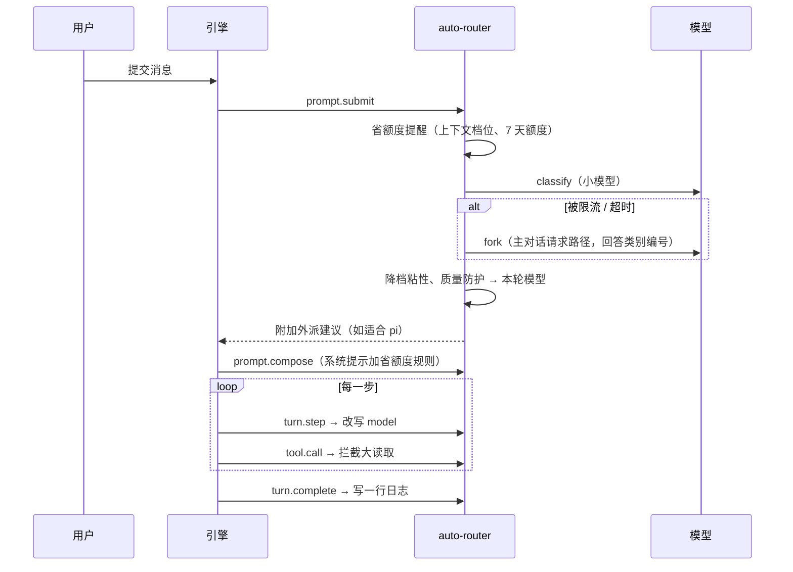

# 架构与工作原理

auto-router 是一个 Claude Code mod（插件里的 `hooks/register.tsx` 模块），在引擎的事件上挂钩子，做四件事：

1. **模型切换**：每条消息先分类，按类别把本轮主对话换成 haiku / sonnet / opus。
2. **pi 外派**：注册 `pi_dispatch` 工具，Claude 把写得清楚的执行活交给 [pi](https://www.npmjs.com/package/@earendil-works/pi-coding-agent)，在非 Claude 模型上跑。
3. **省额度**：拦下会把大量内容灌进上下文的调用，上下文过大时提醒交接，把省额度规则写进系统提示，带上 scout / executor 子代理。
4. **对照实验**：按会话随机分组，衡量前三件事到底省了多少、质量有没有下降。

省钱有两条路：**省 token**（上下文更短、读得更少）和**省额度**（同样的活换便宜的模型，或交给不占 Claude 额度的 pi）。下面按模块说明。

## 模块结构

```
hooks/
  register.tsx   入口：把各模块接到引擎事件上；pi 任务的派发、排队、熔断；斜杠命令和工具
  classify.ts    分类（classify → fork 兜底）、降档粘性、质量防护、分类器自检
  saver.ts       省额度的纯函数：拦截规则、图片尺寸、提醒文案、系统提示规则
  stats.ts       日志格式、效果汇总、对照实验分组与报告
  config.ts      配置的默认值、读写、校验、pi 模型链排序、高峰时段
  core.ts        共用运行时：配置读写、会话分组、日志读写、pi 工具注册
  panel.tsx      /auto-router 设置面板（四页）
agents/          scout（只读调研）、executor（按清单执行）子代理
skills/delegate  交活前的判断表和任务清单模板
scripts/         img_check.py：图片预览、联系表、局部裁剪
types/           插件状态和决策记录的类型
tests/           集成测试（用 claude-code/testing 的引擎替身）
```

## 一条消息经过哪些钩子



## 1. 模型切换

### 分类

`classify.ts` 的 `classifyRequest`：

1. 先用 `$.model.classify`（引擎的小模型，最便宜），超时 4 秒。
2. 失败了改用 `$.model.fork`：沿用主对话上一轮的请求和提示词缓存，追加一句"只回答类别编号"，由主对话的模型回答，超时 10 秒。回答取第一个整数，按编号对应类别（`pickByNumber`）。
3. classify 超时或返回 429 一次后，30 分钟内跳过它，直接 fork。

**为什么需要 fork**：实测 7 天额度用到八成以上时，插件自己发起的模型请求（classify、complete，haiku 和 sonnet 都一样）全部返回 `HTTP 429 rate_limit` 或拖到超时，而主对话自己的请求路径照常可用。早期版本把这种情况一律记成"超时"，看起来像网络问题，其实是限流。

**fork 的代价**：每条消息多一次请求，主要是按 0.1 倍价读一遍缓存里的上下文，输出只有一个数字。上下文 20 万时约等于 2 万 token 的输入。引擎的会话花费已经包含这部分（`router_config probe` 实测 fork 前后会话花费的增量与 fork 用量一致）。

**什么时候不 fork**：已经在 Opus，且上下文超过 `keepAboveTokens`（此时不降档）时，分出什么类别模型都不会变，就不 fork，日志记 `cf: skip`。classify 能用时照常调用，因为它很便宜，还能给出外派建议。

会话第一条消息之前还没有可 fork 的请求；classify 也不可用时，这一条不切换。

### 降档粘性和质量防护

- 升档立即生效；降档要连续 `downgradeAfter`（默认 2）轮都判为更轻才降。一句"好的，继续"不会把正在写代码的会话降到 haiku，也减少换模型带来的缓存失效。
- 用户在纠正上一轮（"不对""重做""还是不行"）时升一档。
- 上下文超过 `keepAboveTokens`（默认 15 万）时不降档：换模型要把整段上下文重写进缓存（1.25 倍价），省下的可能还不够补。

### 改写模型

`turn.step` 钩子在每一步把 `model` 换成本轮决定的模型。子代理的请求不改。对照组只记录"本来会选什么"，不改。

## 2. 外派（pi / opencode）

- `pi_dispatch` 工具的说明是根据当前配置生成的，列出每个角色和它依次尝试的模型，每个模型前标 `[pi]` 或 `[opencode]`。配置变了就重新注册。工具名沿用 `pi_dispatch`，不改名，以免已有的提示词和技能失效。
- **通道**：模型名以 `opencode/` 开头的走 `opencode run`，其余走 pi（`channelOf`）。一条链里可以混着两条通道，按顺序试。结果头写成 `[opencode p1a2b3c4] 完成 · opencode/glm-5.3-flash-free`，任务记录、状态行（`🚀 opencode · 文本 · glm-5.3-flash-free 运行中`）和日志（`ch` 字段，旧记录按模型前缀推断）都带通道。
- **模型链**：每个角色按"强 / 中 / 轻"档位排；同一档里按计费 免费 → 订阅 → 按量付费，再按 `pi.strengths`（擅长这个角色的在前，没标的居中，专长别的角色的在后）。跳过关掉的提供商、处在高峰时段的提供商、被熔断暂停的提供商、已下架或隐私开关不允许的免费模型；都用不了时用 `pi.fallback`；兜底也不行才排队到下一个空闲时段。
- **运行时兜底**（`runChain`）：角色链的模型依次试，一个失败换下一个；整条都失败后接着试 `pi.fallback` 里还没试过的。另外三条：
  - 一家超时后，同一任务不再试这家的其他模型；
  - 可写任务失败时如果工作区已经有改动，就停下来，不让下一个模型在半成品上接着改；
  - 指定了模型（`model` 参数）时只试那一个。
- **熔断**：报鉴权或额度类错误（没有 / 无效的 api key、401/403、订阅失效、402、429、quota、usage limit、too many requests、没登录）时，整家暂停 `pauseMinutes` 分钟。pi 只看 stderr，退出码非 0 且 stdout 很短时才连 stdout 一起看，免得模型回答里提到 "rate limit" 也熔断。opencode 的免费模型算一家：任何一个限流，整个 opencode 暂停。opencode 只看 stderr 和 error 事件的消息，不看工具输出，免得读到的文件里碰巧有 "api key" 就熔断。
- **安全**：只读角色强制禁用 edit / write / bash（pi 用 `--exclude-tools edit,write,bash`，opencode 见下）。可写角色要求工作目录是 git 仓库、工作区干净、同一仓库没有别的可写任务在跑；跑完附上 `git diff --stat`，由 Claude 审阅，不自动提交。两条通道一样。
- **隔离用户自己装的东西**：外派出去的模型只该碰工作目录。实测两边默认都会带上用户的全局配置：
  - pi 会加载 `~/.pi/agent` 下的扩展、MCP 和技能。作者机器上只读任务也拿得到 `subagent`、`act_ui`（操控桌面）、`launch_browser`、`web_search` 和知识库 MCP（含能写入的 `add_to_inbox`）。所以每次都加 `--no-mcp --no-extensions --no-skills --no-prompt-templates`，只把 `pi.keepExtensions` 里的扩展（默认只拦危险命令的 `cc-safety-net`）用 `-e` 加回来。项目和全局的 AGENTS.md 照常读。
  - opencode 见下一节。
- **超时能杀干净**：Windows 上 npm 装的 `pi`、`opencode` 是 `.cmd` 外壳。经 `cmd /d /c` 起的话，超时只杀掉 cmd，真正干活的 node / opencode.exe 成了孤儿，管道不关，任务一直挂着（实测：kill 后 opencode.exe 还在、close 事件不来）。所以先 `where xxx.cmd`，从外壳里读出真正的程序（`.exe` 直接起，`.js` 交给外壳旁的 node.exe）直接起（`launcher` / `parseShim`）；读不出来才退回 `cmd /d /c`。每个会话开始时重新找一次。
- Windows 上每次调 pi / opencode 前从注册表读一遍用户级环境变量，Claude 启动后才设置的 key 也能用上。

### opencode 通道

实测 opencode 1.19.5 和 2.2.5（Windows 11）：

- 直接起 `opencode.exe`（不经 cmd，见上）；任务从 stdin 传，不拼进命令行（避免引号和长度问题）。按 `--version` 的大版本拼参数：
  - 1.x：`run -m <模型> --format json --dir <目录> --agent <代理>`；
  - 2.x：`run -m <模型> --format json --agent <代理> --standalone`，目录取进程的工作目录（2.x 去掉了 `--dir`）。2.x 的 `run` 默认连后台常驻服务，我们注入的环境变量（代理配置、隔离的配置目录）到不了那个服务，报 "Agent not found"；`--standalone` 起一个自己的服务，环境变量才生效。
- opencode 会自己升级，2.x 换了包名（`@opencode/cli`），程序路径跟着变。所以每次起之前检查缓存的程序路径还在不在，不在就重新从 `.cmd` 外壳里找；同时设 `OPENCODE_DISABLE_AUTOUPDATE=1`，免得任务中途升级。
- 免费模型有用量上限，**按模型算**：到了以后 error 事件是 `{"type":"provider.free-limit","message":"Free usage limit reached…","status":429,"retryAfterMs":…}`。实测（2026-11-01 晚）glm、deepseek-v4.1、mimo、nemotron-vl 已到上限时，flint、nemotron-lightning 照样能用；`retryAfterMs` 约 12.8 小时。所以撞到 free-limit 只暂停这一个模型（暂停表的键用完整模型名），按 `retryAfterMs` 恢复，不暂停整个 opencode。2.x 的 error 字段是 `type` / `message`，1.x 是 `name` / `data.message`，两种都读。
- `--format json` 每行一个事件：`step_start`、`text`、`tool_use`、`step_finish`、`error`。取最后一步的文字当结果（前面几步多是“我先读一下文件”），最后一步没有文字时取全部文字（`parseOpencodeRun`）。成功退出码 0；模型不存在、限流时退出码 1 并带 `error` 事件。退出码 0 但没有文字也算失败，换下一个模型。
- **只读不能用 `--agent plan`**：`opencode debug agent plan` 显示 plan 只 deny 了 edit，`"*"` 是 allow，bash 还能用，能用 shell 写文件。
- **不带上用户的全局配置**：opencode 默认读 `~/.config/opencode/opencode.json`（作者机器上里面有知识库 MCP，每次 `opencode run` 都会起一个 MCP 进程）、全局 AGENTS.md（含个人规则）、插件，还兼容读 `~/.claude` 下的技能和 CLAUDE.md。这些都会跟着任务发给免费模型。所以每次都：
  - `XDG_CONFIG_HOME` 指到插件自己的 `~/.claude/auto-router/opencode`（空配置；第一次用时 opencode 会在里面装一次依赖，要几十秒，所以打开面板时先跑一次 `opencode models`）；
  - `OPENCODE_DISABLE_CLAUDE_CODE=1`；
  - 用 `OPENCODE_CONFIG_CONTENT` 注入两个代理，权限都是先 `"*": "deny"` 再逐个放开：
    - `auto-router-readonly`：只放开 read、grep、glob、list，读 `*.env` 也 deny；
    - `auto-router-write`：再放开 edit、todowrite 和 bash。bash 明确设成 allow，因为用户配置里 bash 是 `"ask"` 时，`opencode run` 没人点允许，会一直卡着（实测）。第一条是 `"*": "allow"`（opencode 按最后一条匹配的规则算），后面 deny `git commit/push/reset/clean`、递归删除（`rm -r`、`Remove-Item -Recurse`、`rd /s`、`del /s`）和 `Format-Volume`，改动留给 Claude 审阅。
  - 实测：只读代理的模型只看得到 glob、grep、read，没起任何 MCP，说不出全局规则的内容，读 `.env` 被拦；可写代理改文件、跑测试都正常，`git commit` 被拦。
  - 项目目录里的 opencode.json、AGENTS.md 照常生效，那是被派活的项目自己的；项目里配的 MCP 也会起，但 `"*": "deny"` 让模型调不到。
- **下架**：免费模型随时可能下架。打开面板时和每个会话第一次派 opencode 时列一次模型（1.x 用 `opencode models opencode`，约 1.4 秒；2.x 用 `opencode models --standalone` 再挑 `opencode/` 开头的），不在列表里的模型派活时跳过并在结果里写一笔“已下架”；列表取不到（没装 opencode）时不按下架处理。
- **隐私**：依据 [OpenCode Zen 文档](https://opencode.ai/docs/zen) 的隐私说明（2026-11-01 查）：

  | 模型 | 官方说明 | 默认 |
  |---|---|---|
  | glm-5.3-flash-free、deepseek-v4.1-flash-free | 零保留，不拿来训练 | 哪里都能用 |
  | beam-free | 不拿来训练，保留 30 天 | 哪里都能用 |
  | big-pickle、mimo-v2.6-flash-free、flint-40b-free | 免费期间收集的数据可能用来改进模型（flint 保留 30 天） | 只在允许的目录 |
  | nemotron-3.5-super-vl-free、nemotron-3.5-lightning-free | NVIDIA 试用端点：会记录，不要提交个人或机密数据 | 只在允许的目录 |

  会记录的模型列在 `opencode.logged`。`opencode.allowDirs` 默认是 `[]`：会记录的模型哪个目录都不用，零保留的照常用。理由是派出去的任务常带着项目代码、日志和路径，默认不该发给会拿去改进模型的端点；而零保留的模型风险和按量付费的 API 相当，没必要拦。用户可以在「外派模型」页 opencode 一组里一键允许当前目录、全部目录（`["*"]`）或清空。`allowDirs` 有值（且不是 `*`）时说明用户在区分目录，这时长文阅读（longctx，整目录发出去）也只在允许的目录里用 opencode（`privacyBlock`）。
- `OPENCODE_DISABLE_FREE_MODELS=1` 会让 opencode 不列免费模型；这时所有 opencode 模型都按“取不到列表”处理，派活时报错后换下一个。

### 旧配置迁移

0.2.x 的配置文件没有 `opencode` 段。读到这样的文件时（`migrateOpencode`）：

1. 加上 `opencode` 提供商（免费）、opencode 模型的档位（只加用户没写过的键）、`pi.strengths` 和 `opencode` 段；
2. 如果角色和兜底还是 0.2 的默认值，按新档位重排（`buildRoles`）；用户手调过的不动，提示里请用户自己点「按档位重排」；
3. 先把原文件存成 `auto-router.json.bak`，再写回新配置，弹一条提示。

## 3. 省额度

| 手段 | 钩子 | 原理 |
|---|---|---|
| 拦大读取 | `tool.call` | 读大文件（超过 2000 行或 200KB 且没带 offset/limit）、大图（超过 1MB 或长边 1024px）、整页网页、`cat` 大文件、不加过滤的日志命令。第一次拒绝并给出更省的读法，10 分钟内原样再请求就放行，最坏情况等于没装。出错一律放行 |
| 上下文提醒 | `prompt.submit` | 上下文越过 30 万、60 万时各提醒一次：交接后开新会话，或 `/compact` |
| 额度提醒 | `prompt.submit` | 7 天额度用过 `quotaPct` 后，提醒大量阅读优先派给 pi longctx |
| 系统提示规则 | `prompt.compose` | "节省上下文、决策与执行分离"规则写在会话段（`scope: session`），只随配置变化，不影响提示词缓存 |
| 子代理 | `agent.offer` | scout（只读调研，Sonnet）、executor（按清单执行）；省额度关掉时不提供 |

**大量阅读交给谁**（`bigRead: auto`）：

1. 原文不到约 3 万 token：自己读，交给子代理的启动开销反而更大；
2. 要上网、要调 MCP，或材料私密：scout；
3. 超过约 20 万 token，或 7 天额度已过阈值：pi longctx（DeepSeek 1M 上下文，不占 Claude 额度）；
4. 其余：scout。

## 4. 对照实验

见 [experiment.md](experiment.md)。

## 日志

每轮结束、每个 pi 任务、每次拦截各写一行 JSON 到 `~/.claude/auto-router/log/<日期>_<会话id前8位>.jsonl`。每个会话一个文件，整份重写（`$.fs` 没有追加写入），多个会话同时开着也不会互相覆盖。字段定义见 `hooks/stats.ts` 的 `TurnRecord`、`PiRecord`、`GuardRecord`，常用字段：

| 字段 | 含义 |
|---|---|
| `cat` / `pick` / `model` | 分类、路由选的模型、实际模型 |
| `cf` / `cerr` / `cms` / `via` / `fu` | 分类失败原因、报错、耗时、走的哪条路、fork 的 token 用量 |
| `in` / `cw` / `cr` / `out` / `usd` | 输入、缓存写、缓存读、输出 token，这一轮的花费 |
| `ctx` / `wk` | 本轮开始时的上下文 token 数、7 天额度百分比 |
| `sid` / `ex` / `ra` / `sv` | 会话、实验、切换组、省额度组 |

## 写 mod 时遇到的引擎约束

后来维护的人容易踩到这些：

- `$` 只能传给本文件声明的函数，或者从别的文件导入的 **function 声明**；传给箭头函数常量或依赖注入进来的函数时，模块会加载失败。
- `read` / `update` 用到的 atom 必须在同一个文件里用 `atom(...)` 声明，所以同一个 atom（plugin 和 key 相同）会在多个文件里各声明一份。
- `prompt.submit` 这类不带匹配条件的事件，每个模块只能注册一个钩子。
- 测试里的引擎替身要让操作失败，应返回 `{ deny }`；直接抛异常不会让操作失败。
