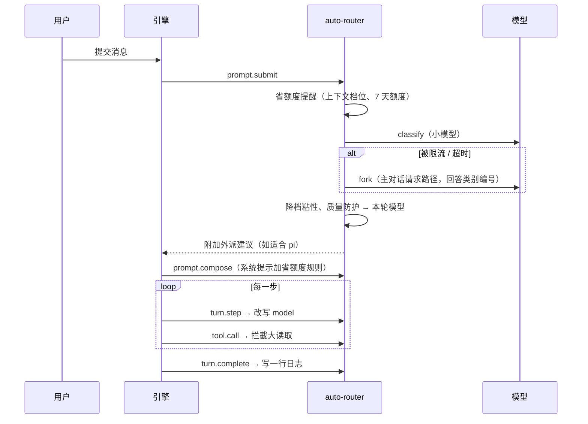

# 架构与工作原理

auto-router 是一个 Claude Code mod（插件里的 `hooks/register.tsx` 模块），在引擎的事件上挂钩子，做四件事：

1. **模型切换**：每条消息先分类，按类别把本轮主对话换成 haiku / sonnet / opus。
2. **pi 外派**：注册 `pi_dispatch` 工具，Claude 把写得清楚的执行活交给 [pi](https://www.npmjs.com/package/@earendil-works/pi-coding-agent)，在非 Claude 模型上跑。
3. **省额度**：拦下会把大量内容灌进上下文的调用，上下文过大时提醒交接，把省额度规则写进系统提示，带上 scout / executor 子代理。
4. **对照实验**：按会话随机分组，衡量前三件事到底省了多少、质量有没有下降。

省钱有两条路：**省 token**（上下文更短、读得更少）和**省额度**（同样的活换便宜的模型，或交给不占 Claude 额度的 pi）。下面按模块说明。

## 模块结构

```
hooks/
  register.tsx   入口：把各模块接到引擎事件上；pi 任务的派发、排队、熔断；斜杠命令和工具
  classify.ts    分类（classify → fork 兜底）、降档粘性、质量防护、分类器自检
  saver.ts       省额度的纯函数：拦截规则、图片尺寸、提醒文案、系统提示规则
  stats.ts       日志格式、效果汇总、对照实验分组与报告
  config.ts      配置的默认值、读写、校验、pi 模型链排序、高峰时段
  core.ts        共用运行时：配置读写、会话分组、日志读写、pi 工具注册
  panel.tsx      /auto-router 设置面板（四页）
agents/          scout（只读调研）、executor（按清单执行）子代理
skills/delegate  交活前的判断表和任务清单模板
scripts/         img_check.py：图片预览、联系表、局部裁剪
types/           插件状态和决策记录的类型
tests/           集成测试（用 claude-code/testing 的引擎替身）
```

## 一条消息经过哪些钩子



## 1. 模型切换

### 分类

`classify.ts` 的 `classifyRequest`：

1. 先用 `$.model.classify`（引擎的小模型，最便宜），超时 4 秒。
2. 失败了改用 `$.model.fork`：沿用主对话上一轮的请求和提示词缓存，追加一句"只回答类别编号"，由主对话的模型回答，超时 10 秒。回答取第一个整数，按编号对应类别（`pickByNumber`）。
3. classify 超时或返回 429 一次后，30 分钟内跳过它，直接 fork。

**为什么需要 fork**：实测 7 天额度用到八成以上时，插件自己发起的模型请求（classify、complete，haiku 和 sonnet 都一样）全部返回 `HTTP 429 rate_limit` 或拖到超时，而主对话自己的请求路径照常可用。早期版本把这种情况一律记成"超时"，看起来像网络问题，其实是限流。

**fork 的代价**：每条消息多一次请求，主要是按 0.1 倍价读一遍缓存里的上下文，输出只有一个数字。上下文 20 万时约等于 2 万 token 的输入。引擎的会话花费已经包含这部分（`router_config probe` 实测 fork 前后会话花费的增量与 fork 用量一致）。

**什么时候不 fork**：已经在 Opus，且上下文超过 `keepAboveTokens`（此时不降档）时，分出什么类别模型都不会变，就不 fork，日志记 `cf: skip`。classify 能用时照常调用，因为它很便宜，还能给出外派建议。

会话第一条消息之前还没有可 fork 的请求；classify 也不可用时，这一条不切换。

### 降档粘性和质量防护

- 升档立即生效；降档要连续 `downgradeAfter`（默认 2）轮都判为更轻才降。一句"好的，继续"不会把正在写代码的会话降到 haiku，也减少换模型带来的缓存失效。
- 用户在纠正上一轮（"不对""重做""还是不行"）时升一档。
- 上下文超过 `keepAboveTokens`（默认 15 万）时不降档：换模型要把整段上下文重写进缓存（1.25 倍价），省下的可能还不够补。

### 改写模型

`turn.step` 钩子在每一步把 `model` 换成本轮决定的模型。子代理的请求不改。对照组只记录"本来会选什么"，不改。

## 2. pi 外派

- `pi_dispatch` 工具的说明是根据当前配置生成的，列出每个角色和它依次尝试的模型。配置变了就重新注册。
- **模型链**：每个角色按"强 / 中 / 轻"档位和"订阅 / 按量付费"排序；跳过关掉的提供商、处在高峰时段的提供商、被熔断暂停的提供商；都用不了时用 `pi.fallback`；兜底也不行才排队到下一个空闲时段。
- **熔断**：报鉴权或额度类错误（没 key、401/403、订阅失效、429）时，整家暂停 `pauseMinutes` 分钟。
- **安全**：只读角色强制禁用 pi 的 edit / write / bash。可写角色要求工作目录是 git 仓库、工作区干净、同一仓库没有别的可写任务在跑；跑完附上 `git diff --stat`，由 Claude 审阅，不自动提交。
- Windows 上每次调 pi 前从注册表读一遍用户级环境变量，Claude 启动后才设置的 key 也能用上。

## 3. 省额度

| 手段 | 钩子 | 原理 |
|---|---|---|
| 拦大读取 | `tool.call` | 读大文件（超过 2000 行或 200KB 且没带 offset/limit）、大图（超过 1MB 或长边 1024px）、整页网页、`cat` 大文件、不加过滤的日志命令。第一次拒绝并给出更省的读法，10 分钟内原样再请求就放行，最坏情况等于没装。出错一律放行 |
| 上下文提醒 | `prompt.submit` | 上下文越过 30 万、60 万时各提醒一次：交接后开新会话，或 `/compact` |
| 额度提醒 | `prompt.submit` | 7 天额度用过 `quotaPct` 后，提醒大量阅读优先派给 pi longctx |
| 系统提示规则 | `prompt.compose` | "节省上下文、决策与执行分离"规则写在会话段（`scope: session`），只随配置变化，不影响提示词缓存 |
| 子代理 | `agent.offer` | scout（只读调研，Sonnet）、executor（按清单执行）；省额度关掉时不提供 |

**大量阅读交给谁**（`bigRead: auto`）：

1. 原文不到约 3 万 token：自己读，交给子代理的启动开销反而更大；
2. 要上网、要调 MCP，或材料私密：scout；
3. 超过约 20 万 token，或 7 天额度已过阈值：pi longctx（DeepSeek 1M 上下文，不占 Claude 额度）；
4. 其余：scout。

## 4. 对照实验

见 [experiment.md](experiment.md)。

## 日志

每轮结束、每个 pi 任务、每次拦截各写一行 JSON 到 `~/.claude/auto-router/log/<日期>_<会话id前8位>.jsonl`。每个会话一个文件，整份重写（`$.fs` 没有追加写入），多个会话同时开着也不会互相覆盖。字段定义见 `hooks/stats.ts` 的 `TurnRecord`、`PiRecord`、`GuardRecord`，常用字段：

| 字段 | 含义 |
|---|---|
| `cat` / `pick` / `model` | 分类、路由选的模型、实际模型 |
| `cf` / `cerr` / `cms` / `via` / `fu` | 分类失败原因、报错、耗时、走的哪条路、fork 的 token 用量 |
| `in` / `cw` / `cr` / `out` / `usd` | 输入、缓存写、缓存读、输出 token，这一轮的花费 |
| `ctx` / `wk` | 本轮开始时的上下文 token 数、7 天额度百分比 |
| `sid` / `ex` / `ra` / `sv` | 会话、实验、切换组、省额度组 |

## 写 mod 时遇到的引擎约束

后来维护的人容易踩到这些：

- `$` 只能传给本文件声明的函数，或者从别的文件导入的 **function 声明**；传给箭头函数常量或依赖注入进来的函数时，模块会加载失败。
- `read` / `update` 用到的 atom 必须在同一个文件里用 `atom(...)` 声明，所以同一个 atom（plugin 和 key 相同）会在多个文件里各声明一份。
- `prompt.submit` 这类不带匹配条件的事件，每个模块只能注册一个钩子。
- 测试里的引擎替身要让操作失败，应返回 `{ deny }`；直接抛异常不会让操作失败。
