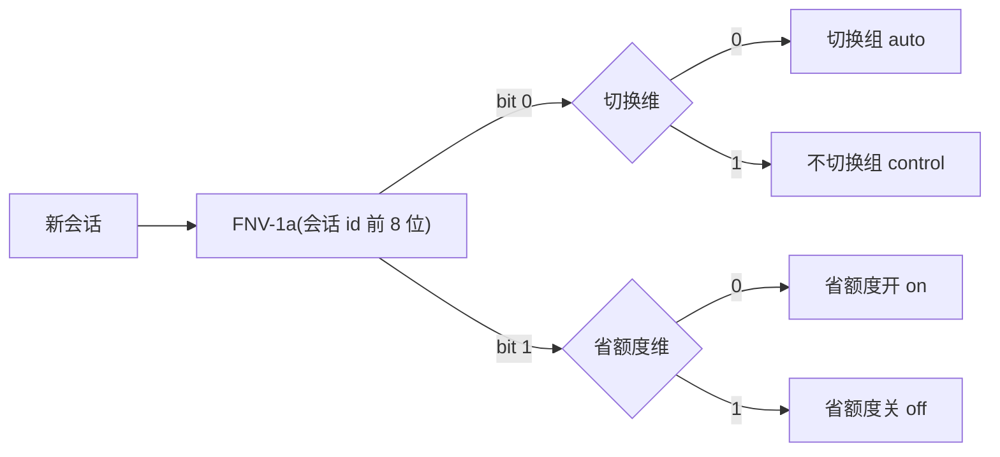

# 对照实验设计

目的：回答两个问题。

- **模型切换**省钱吗？它会不会让回答变差？
- **省额度**那一套（拦截、提醒、规则、子代理）真的让会话更便宜吗？

## 分组



- `experiment` 设成 `route`（只测切换）、`saver`（只测省额度）或 `both`（2×2 析因），在面板 Claude 页"更多设置"里选。
- 分组由会话 id 的哈希决定（`stats.ts` 的 `sessionArms`）：同一会话重载插件后分组不变，不需要另外存状态。两维各取哈希的一位，相互独立，`both` 时四格各占约四分之一。
- **对照组的做法**：
  - 不切换组：照常分类，日志里记下"本来会选什么"，但不改模型。分类本身的开销两组一样，比较的只是切换带来的效果。
  - 省额度关：不拦截、不提醒、不写规则、不提供 scout / executor。
- **只收新会话**：实验打开时已经开着的会话不入组。它的日志里已有不带实验标记的记录，中途入组会把前后两段混在一起。判断方法是看会话的第一条日志有没有 `ex` 字段（`core.ts` 的 `startedOutside`）。
- 面板"对照实验"下方和 `/auto-router eval` 的第一行都会显示本会话的分组。

**为什么按会话分组而不是按天**：省额度的主要收益是会话变短、上下文变小，必须以整个会话为单位才看得出来。按会话随机分组，同一天里做的各种活会均匀落到两组，比按天轮换更可比。

## 指标

每个会话先汇总，再在组之间比较（`sessionStats` → `cellStats` → `experimentReport`）：

| 指标 | 算法 | 看什么 |
|---|---|---|
| **每会话花费**（主指标） | 每个会话的总花费取 log(花费 + 0.01)，组内求平均和标准误；显示时换回美元（几何平均） | 做完一件事花多少钱 |
| 每轮花费 | 每个会话的"花费 ÷ 主对话轮数"，组内平均 | 只作参考：省额度让会话变短时，每轮花费可能反而变高 |
| 每会话轮数、花费 | 组内算术平均 | 会话是否变短 |
| 平均上下文、到过 30 万的会话占比 | 每轮开始时的上下文 token 数 | 省 token 的直接证据 |
| 7 天额度 | 会话内百分比的累计涨幅（额度窗口重置后的回落不算）；只用没和别的会话同时开着的会话 | 订阅额度消耗 |
| 外派次数 | 每组派给 pi / opencode 的任务数 | 外派模型的花费不在 Claude 花费里，省下的可能挪到了外派 |
| 纠正率 | 用户说"不对 / 重做"这类话的轮次占比 | 质量是否下降 |
| 拦截、再请求率 | 拦下次数；其中被原样再请求的比例 | 误拦率的上限 |
| 子代理花费占比 | scout / executor 的花费占比 | 省下的是否被子代理吃掉 |
| fork 分类占比 | 按上一轮模型的官方价算 fork 用量的花费 | 分类自己花了多少 |

花费是引擎按 API 价折算的美元，包括子代理和 fork 分类（引擎的会话花费已含 fork，报告里只单独显示占比，不重复加）。订阅额度不按这个数扣，但两组之间的比例可以参考。

## 怎么下结论

```
差值 = 实验组 log 花费平均 − 对照组 log 花费平均
合并标准误 = √(SE实验² + SE对照²)
变化 = e^差值 − 1
```

- 两组各有至少 15 个会话（`MIN_SESSIONS`），且 |差值| > 2 × 合并标准误，才写"确实省了 X%"或"反而多花 X%"；
- 样本不够时写"样本还不够：每组要 15 个会话，还差 N 个"；差值在误差范围内时写"还说不准"。
- 不到 3 轮（`MIN_TURNS`）的会话不算：多是开了就关、问一句就走，和正常干活的会话不可比；报告第一行写明去掉了几个。
- `claude -p`、定时任务这类会话一般只有一两轮，靠上一条去掉。不按引擎的 `isInteractive` 判断：实测桌面 app 里和 `/reload-plugins` 之后它会给 false，把正常会话踢出实验。

**为什么用几何平均**：会话花费长尾很重，一个大会话能抵十几个小会话，算术平均会被它左右，要很多样本才稳。取对数后比较的是"典型会话"贵了还是便宜了，几个极端会话影响小得多。

以会话为单位求标准误，而不是以轮为单位：同一会话里的各轮高度相关，按轮算会把样本量算大，结论显得过于确定。

## 局限

- **任务不同**：两组做的活不一样时，差异也可能来自任务本身。会话越多，这种偏差越小。
- **额度是共用的**：7 天额度按账号算，同时开着的会话会互相算进对方的涨幅，所以只用单独开着的会话；同时开的多了，这一项样本会很少。
- **手动换模型**：会话里手动 `/model` 换过模型的，切换组和不切换组的区别会变小。
- **质量指标粗**：纠正率只能识别明确说出来的不满，看不到默默重写的情况。
- **分类失败的轮次不切换**：2026-11-01 起 `claude.forkFallback` 默认关，classify 被限流或超时的轮次保持当前模型（之前只有会话第一条消息这样）。额度紧时这种轮次多，切换组的效果会被低估；报告里看分类失败的占比。
- **切换做法改过**：同一天起降档默认要连续 4 轮。0.3.1 起每条日志带配置版本 `cv`，报告默认只比当前版本的会话（见下节），旧做法的会话不会混进结论。
- **0.4.0 起只在冷点换模型**：切换组只在冷点分类和换模型，冷点上换模型不算缓存重写的钱。版本号变了，报告从新版本重新攒样本；报告里“冷点”一行看冷点占比和升档次数，“本地规则”一行看规则和小模型的一致率。同一版本起最低用到 Sonnet（`claude.floor`），切换组和对照组的差别主要在 Sonnet 和 Opus 之间，换模型能省的上限约 28%（两者读缓存一个价），样本要攒得更久才看得出差别；报告末尾的“花费构成”看额度花在读缓存、写缓存还是输出上。
- **单价用官方价**：fork 占比和面板“省了多少”按 Anthropic 官方价（`hooks/stats.ts` 的 `PRICES`，缓存写 2 倍）逐轮算。不再从日志反推：每轮 usd 是会话累计花费的差，没单独记的调用会落进下一轮，反推出的 Haiku 单价只比 Opus 低 20%。会话总花费（主指标）仍用引擎的数。

## 按配置版本比较

改了切换或省额度的做法（插件升级，或改了 `claude`、`saver`、`experiment` 里任何一项）以后，新旧做法的会话混在一起比，结论会被旧数据拖着走。所以：

- 每条日志带配置版本 `cv`（插件版本 + 这三段配置的哈希）。外派模型顺序、提供商、界面设置不算：它们常改，又不影响 Claude 这边的花费，算进去会把样本切得太碎。
- 实验开着时，报告只比**当前配置版本**的会话；实验关着时比日志里最近的一版。
- 中途改过配置或升级了插件的会话两边都不算（报告里写“另有 N 个会话中途改过配置”）。
- 窗口里有多个版本时，报告末尾列“按配置版本”：每版的日期范围、会话数、各组的每会话花费，只作参考。
- 代价是每改一次配置，样本要从头攒。所以想测清楚就先别动这三段配置，等每组攒够 15 个会话。

## 运行实验

1. `/auto-router` → Claude 页 → 更多设置 → 对照实验，选 `both`（或只测一维）。
2. 如果以前手工配过同类规则（CLAUDE.md 里的省 token 规则、settings.json 里拦截大读取的钩子），先撤掉，否则"省额度关"组并不是真的关。
3. 照常使用。新开的会话会自动分组。
4. 隔一两周运行 `/auto-router eval 14`，看各维的结论；「效果」页也有摘要。
5. 想自己分析时，原始日志在 `/auto-router path` 显示的目录里，一行一轮。
6. 想每周自动出周报：让任何平台的定时任务照 [weekly-report.md](weekly-report.md) 写，它只读插件生成的 `report/latest.md`。
